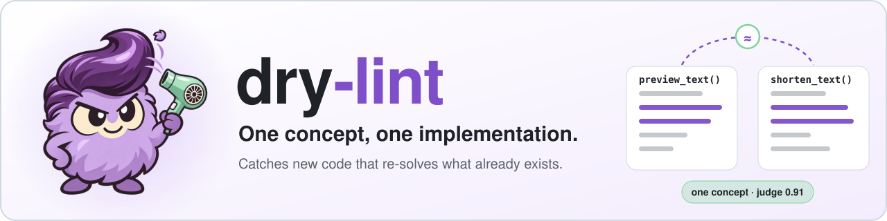
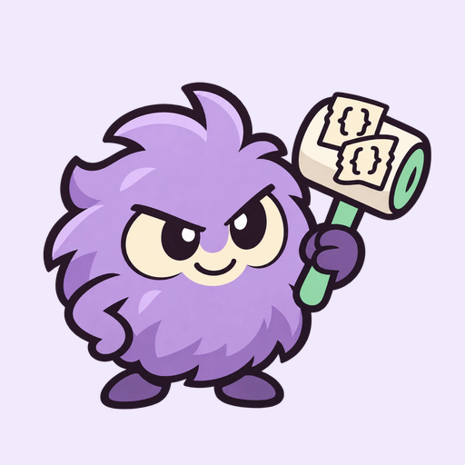

<p align="center">
  <picture>
    <source media="(prefers-color-scheme: dark)" srcset="docs/assets/readme-hero-dark.svg">
    
  </picture>
</p>

<p align="center">
  <a href="https://pypi.org/project/dry-lint/"></a>
  <a href="https://github.com/gigaverse-app/dry-lint/actions/workflows/ci.yml"></a>
  <a href="#the-counter"></a>
  <a href="pyproject.toml"></a>
  <a href="docs/typescript.md"></a>
  <a href="LICENSE"></a>
  <a href="https://dry-lint.readthedocs.io/en/latest/"></a>
</p>

<p align="center"><a href="docs/why.md">Why dry-lint</a> · <a href="docs/tutorials/first-run.md">First-run tutorial</a> · <a href="docs/ci.md">How CI runs it</a> · <a href="https://dry-lint.readthedocs.io/en/latest/">Documentation</a> · <a href="https://dry-lint.readthedocs.io/en/latest/ecosystem/">Related tools</a></p>

Coding agents rarely copy and paste. They write *new* code for a job the codebase already does: a second
`truncate`, another pagination loop, a fresh Mongo query helper, each slightly different. Copy-paste detectors
(pylint's `duplicate-code`, jscpd) look for repeated lines, so they miss this. Every rewrite is also a chance to
drift: one version rounds, the other truncates, and callers get different answers to the same question.

dry-lint finds functions in a pull request that look like they re-implement something that already exists. A
judge decides whether each pair really is one concept, and the result goes back as PR annotations and one comment
([see one](docs/comment-preview.md)):

```text
src/widgets/caption.py:1: preview_caption_text looks like src/text.py::shorten_text (drifted)
    judge 0.91; the two already behave differently; call the existing function;
    similarity 0.71; if they are different concepts, add
    `# dry-lint: distinct-from src/text.py::shorten_text`
```

**You bring your own keys.** dry-lint never provides API keys, models or judge execution: judges run on the
credentials your repository passes in, at your cost, and without any it only lists look-alikes
([design](docs/design.md#adopters-bring-their-own-keys)).

<a href="#the-counter">
  <picture>
    <source media="(prefers-color-scheme: dark)" srcset="https://dry-lint-counter.gigaverse-oss.workers.dev/v1/sign.svg?theme=dark">
    
  </picture>
</a>

## Quick start

Python, TypeScript and TSX work out of the box. TypeScript repositories need no Python project, `bun install`,
Node or build step: dry-lint installs its own tools and parses source without executing your code
([TypeScript and Bun](docs/typescript.md) covers monorepos).

### Try it locally, without an API key

Install [uv](https://docs.astral.sh/uv/getting-started/installation/), open a terminal in your Git repository,
and run:

```bash
uvx --no-config --python 3.13 dry-lint scan --judge none --limit 30
```

uv downloads Python and runs dry-lint in its own environment, so nothing is added to your project. This lists
look-alikes without calling a model or failing on findings. To inspect just your branch, replace
`scan --judge none --limit 30` with `check --judge none --base origin/main` (use your default branch's name).

For a permanent `dry-lint` command, then open a new terminal:

```bash
uv tool install --no-config --python 3.13 dry-lint
uv tool update-shell
```

### Add it to GitHub Actions

Save this as `.github/workflows/dry-lint.yml`. It works without a secret; add a `TYPESAFE_AI_API_KEY`
repository secret when you want judged findings.

```yaml
name: dry-lint
on: [pull_request]
permissions:
  contents: read
  pull-requests: write
concurrency:
  group: dry-lint-${{ github.event.pull_request.number }}
  cancel-in-progress: true
jobs:
  dry-lint:
    runs-on: ubuntu-latest
    steps:
      - uses: actions/checkout@v7
        with:
          ref: ${{ github.event.pull_request.head.sha || github.sha }}
          fetch-depth: 1
      - uses: gigaverse-app/dry-lint@v1
        with:
          typesafe-api-key: ${{ secrets.TYPESAFE_AI_API_KEY }}
```

The action installs its own Python and dependencies; your project's Python version, uv configuration and
virtual environment do not change, and no `setup-python`, `pip install` or build step is needed. It annotates
the changed functions, keeps one sticky PR comment up to date and caches verdicts between runs. The comment
links both functions at the analyzed commit, shows the review workload, and folds evidence and pair-specific
suppression instructions under each summary. A clean pull request gets a green sticky with what was checked
(`comment-on-clean: "false"` to opt out), and every sticky keeps a running account of what each push cost and
each duplicate kept out ([the ledger](docs/github-action.md#the-ledger)).

A reported duplicate fails the check at the preset's threshold (98% of them are real duplicates with
`jev+opus`); `fail-at` raises or lowers it, and the `dry-lint: override` label lets one through. That precision
is for people. A coding agent can check findings itself, so for agents a cheap judge at a lower threshold catches
more for less ([who reads the findings](docs/judges.md#who-reads-the-findings-people-or-coding-agents)). Pull
requests from forks get no secrets, so the default `mode: auto` runs dry-lint as two jobs for them: `detect` on the pull
request, and `judge` in [a `workflow_run` job](examples/dry-lint-judge.yml) that keeps the key away from pull
request code ([design](docs/design.md#two-jobs-in-ci)). For default-branch runs and rechecks when override
labels change, use the [extended workflow](examples/dry-lint.yml); the [action guide](docs/github-action.md)
lists every option.

### pre-commit

```yaml
default_install_hook_types: [pre-commit, prepare-commit-msg]
repos:
  - repo: https://github.com/gigaverse-app/dry-lint
    rev: v1
    hooks:
      - id: dry-lint
      - id: dry-lint-trailers  # optional: the pull request's comment counts what the hook kept out
```

The hook checks the staged Python, JavaScript and TypeScript for the coding agent making the commit. An agent checks
each finding itself, then reuses the existing function or records why the two differ, so the hook judges for
recall: preset `agent`, Jev on every pair, blocking from 0.6. That keeps 92% to 100% recall on four gold sets, with
about one finding in two real, for about $0.0002 a commit. Set `TYPESAFE_AI_API_KEY` in the environment or in an
untracked `.env`; nothing else is needed. `args: [--preset, agent+haiku]` adds Claude Haiku on Jev's uncertain
scores, for higher precision and some lost recall on TypeScript; `args: [--preset, auto]` gives a person committing
by hand the same precision-first judging as CI
([who reads the findings](docs/judges.md#who-reads-the-findings-people-or-coding-agents)).

A blocked commit names the pair. Fix it by reusing the existing function, or record an intentional difference with
`# dry-lint: distinct-from path::name` or `dry-lint feedback dismiss PAIR --reason ...`. For wider exploration with a
persistent campaign budget, see [`balanced`](docs/production-discovery.md).

A duplicate the hook blocks and the agent fixes never reaches a push, so CI alone would never count it. The hook
remembers what it blocked; `dry-lint-trailers` writes what was then fixed or dismissed into the commit message,
`Dry-Lint-Kept-Out: ab7719f1ec3f9b70 repository_counter_name ≈ counter_key (3 lines)`, and the pull request's
sticky, the repository's ledger and the [global counter](#the-counter) count it
([the ledger](docs/github-action.md#the-ledger)). Run `pre-commit install` once more after adding it.

## Commands

| Command | Does |
| --- | --- |
| `check [--base REF \| --staged]` | detect, judge and report the functions a change touched (base: `origin/HEAD`) |
| `scan [--limit N] [--refresh] [--repo OWNER/NAME=PATH ...]` | the repository's backlog, or cross-repository pairs from a combined workspace |
| `sweep [--init \| --update]` | audit the configured repository; explicitly initialize or shrink its accepted backlog and README progress |
| `config` | which judges, thresholds and budget would run, and what they cost |
| `explain A B` | why a pair is, or is not, reported |
| `detect --out candidates.json` | CI job 1: propose pairs; no judge, no secrets, no store |
| `judge --candidates candidates.json` | CI job 2: judge them, store the verdicts, report |
| `report --from report.json --format F` | render a report as `text`, `github`, `markdown`, `json`, `sarif` or `check-run` |
| `bench --gold gold.jsonl [--comparer]` | measure the judge, or the comparer, on a gold set |
| `bench --replay N [--preset P] [--fail-at X] [--label K]` | what `check` would have done on each of the last N commits of the default branch; with `--label`, what it would have caught, missed and blocked wrongly |

`--report report.json` and `--output comment.md` write the report and the PR comment from any command that
judges. Without a judge, dry-lint lists the candidate pairs and never fails. With `TYPESAFE_AI_API_KEY` set, Jev
judges them; to use another judge, pass `--judge command --judge-command "your-llm-cli"`
([judges](docs/judges.md)).

| To | Read |
| --- | --- |
| Fully adopt hooks, PR/README stickies and a shrinking backlog | [Adoption playbook](docs/adoption-playbook.md) |
| Set it up with an agent | [skills/dry-lint/SKILL.md](skills/dry-lint/SKILL.md) |
| See the PR comment before installing | [Example report](docs/comment-preview.md) |
| Put judged findings on pull requests | [GitHub Action setup](docs/github-action.md) |
| Add structural matching | [The optional Dryer comparer](docs/detectors.md) ([compared on gigaverse-backend](docs/dryer-comparison.md)) |
| Find copies across related repositories | [Workspace scans and shared ownership](docs/workspaces.md) |
| Avoid cloning peer repositories in CI | [Versioned function indexes](docs/function-indexes.md) |
| Audit existing duplication, shrink its baseline and show cleanup in your README | [Repository sweeps and ratchets](docs/sweeps.md) |

## How it works

dry-lint is a fixed core (the pipeline, the file formats, the verdict store's rules and the reports) with four
plugin slots: how functions are found, how they are compared, how a pair is judged, and where verdicts are kept
([design](docs/design.md), [plugins](docs/plugins.md)).

1. **Detector** (local, no model, about 4.5 s on 10,000 functions). It finds the functions the diff touched. The
   **comparer** proposes each one's nearest look-alikes in other files; the built-in one is a TF-IDF fingerprint
   of what a function *does*: the names it calls, the attributes it touches, the words in its identifiers, its
   loops, `try` blocks and `await`s. One shared policy consumes language-adapter facts: Python special methods, recognized forwarding wrappers,
   a function that calls the other (resolved within the file), declared patterns and inline `distinct-from`.
   Inheritance alone does not exclude repeated logic.
2. **Judge** (separate and pluggable). [Jev](docs/judges.md) answers three typed questions per pair in about 0.3 s:
   - Is it one concept?
   - Do the two already behave differently?
   - Which side should own the single implementation?

   Any LLM CLI, or any program, can be the judge instead, and a second judge can take the scores the first is
   least sure about.
3. **Verdict store** (a cache, not a reviewed file). Each verdict is kept per pair with a *structure hash* of each
   function, which comments and formatting do not change. Python also normalizes local renames; TypeScript
   conservatively re-judges them to preserve binding semantics. Most cosmetic pushes cost zero judge calls.

Research on profiles, judging budgets and discovery across repeated runs is in
[Discovery over time](docs/coverage-exploration.md) and the [four-cent discovery trial](docs/four-cent-discovery.md).

## When it is right not to merge them

Some look-alikes are deliberate. Silence them where the decision belongs:

- **Inline**: put `# dry-lint: distinct-from src/text.py::shorten_text` in the new function. The reason sits next
  to the code it explains, and moves or disappears with it.
- **A whole function**: put `# dry-lint: ignore` in it (generated code, a deliberate copy). It is left out of
  every pair, on either side.
- **Families**: declare a pattern of deliberate per-resource instances in `pyproject.toml`:

```toml
[tool.dry-lint]
exclude = ["*/tests/*", "tests/*", "*/migrations/*"]

[[tool.dry-lint.patterns]]
members = "src/*/api/*_api.py::create_router"
reason = "one router per resource"
```

Machine "not a duplicate" verdicts stay in the store and do not need to be checked in.

## Measured

On 600 gigaverse-ai pull requests, against a 250-pair gold set labelled blind by three vendors' models ([docs/benchmark.md](docs/benchmark.md)):

| | |
| --- | --- |
| Changed functions per commit | median 1, p90 13 |
| Judge calls per PR (uncached) | 2.5 |
| Findings per PR at the default threshold | about 0.2 |
| Jev `reuse-v2`: ranking quality | AUC 0.97 |
| preset `jev+opus`, failing at 0.55, within $0.04 a pull request | 98% precision, 85% recall; about $0.005 per pull request on average |
| preset `jev+sonnet`, failing at 0.7 | 97% precision, 84% recall; about $0.0035 per pull request |
| preset `jev+codex` (ChatGPT subscription), failing at 0.7 | 96% precision, 85% recall; no per-call cost |
| preset `jev`, failing at 0.8 | 94% precision, 73% recall; 15% of pull requests fail |
| Known duplicates found and scored ≥ 0.8 | 11 of 13 |
| Verdict store for the whole repository | about 1,900 pairs, 0.75 MB |

## Settings

All settings live under `[tool.dry-lint]` in `pyproject.toml` or in a `.dry-lint.toml` file. Judges and
thresholds come from the preset ([docs/judges.md](docs/judges.md)); anything set here wins over it:

| Setting | Default | |
| --- | --- | --- |
| `include` / `exclude` | everything / tests, migrations, scripts | fnmatch over tracked paths |
| `neighbours` | 3 | candidates per changed function |
| `preset` | `"auto"` | judges and their measured thresholds together: `jev+opus`, `jev+claude-code`, `jev+sonnet`, `jev+claude-code-sonnet`, `jev+codex`, `sonnet`, `claude-code`, `jev`, `none`; auto picks by the credentials present |
| `drop_below` / `report_at` / `fail_at` | from the preset | separate below, reported at, failing at (`--fail-at` overrides it); `jev+opus` is 0.5 / 0.55 / 0.55, with Jev's answers that Opus did not see held to Jev's 0.8 |
| `drift_at` | 0.8 | a duplicate whose `behaves_differently` reaches this is drifted |
| `budget` | `{ usd = 0.04, subscription_calls = 20 }` | most judging spends on a pull request across all its pushes, at list price, subscriptions included (`--budget-usd`); and calls per run to subscription judges |
| `prices` | built-in table | USD per million input and output tokens, by model |
| `reopen_margin` | 0.05 | for a comparer that permits similarity reuse (no built-in one does), how much closer a "separate" pair must get before it is judged again |
| `max_findings` | 10 | rows in the PR comment |
| `extractors` | `["python", "typescript"]` | `.py`, `.ts`, `.tsx`, `.mts`, `.cts` |
| `comparer` | `"tfidf"` | options `min_similarity` (0.5), `min_similarity_small` (0.3) under `small_function_lines` (6) |
| `judge` / `escalate` | from the preset | name your own judge to run it alone, or `escalate = "none"` to turn the second judge off |
| `store` | `"dir"` | `.git/dry-lint/verdicts/`, or `{ use = "s3", uri = "s3://bucket/prefix" }` |

A plugin slot takes a name, or a table with `use` and the plugin's options:
`comparer = { use = "tfidf", min_similarity = 0.45 }`.


## The counter

The sign at the top counts every duplicate dry-lint has kept out of a codebase: a duplicate a pull request
introduced, dry-lint reported, and a later push removed before merging. A *rewrite* is one whose structure differs
from the function it duplicates, so a copy-paste checker would not see it; a *drifted* copy already behaved
differently; a *re-check skipped* is a verdict the store already held. Actions from November 2026 on measure these;
until a pull request they measured has merged, the sign shows them as "–", never as zero.

When a pull request merges, the action's run on the default branch sends its counts to a
[Cloudflare Worker](counter): duplicates kept out (how many had drifted, how many were rewrites, and their lines),
caught and dismissed, pushes, functions checked, look-alikes compared, verdicts reused, judgments, judging spend
and the dry-lint version. No code, names, paths or people are sent. The repository is **pseudonymous**: it is sent
as its counter key, the SHA-256 of its numeric GitHub id, which ties its pull requests together but which its name
does not lead to; a private repository's id is visible only to people who can see the repository. Each pull
request is counted once. Opt out with `share-totals: "false"`.

A repository whose audit keeps a [README block](docs/sweeps.md#readme-sticky-and-shieldsio-badge) gets its sign
there automatically, beside the old duplicates it has cleaned up and still has. To show it anywhere else, take its counter key from the
log of a dry-lint run on your default branch
(`dry-lint: this repository's counter key is ...`). `name` only labels the sign; the counter never looks a name up:

```html
<picture>
  <source media="(prefers-color-scheme: dark)" srcset="https://dry-lint-counter.gigaverse-oss.workers.dev/v1/sign.svg?theme=dark&key=KEY&name=OWNER/NAME">
  
</picture>
```

or a badge, with `metric=kept-out`, `drifted`, `lines`, `pulls`, `functions` or `repositories`:

```markdown

```

## Lint



Lint is what is left behind when you dry things. It carries a hair dryer for blowing duplicated code away.
`uv run --with pillow python scripts/make_assets.py` rebuilds the avatar, the mark, the banners and the README
hero from [docs/assets/lint.png](docs/assets/lint.png).

<br clear="right">

## License

Apache 2.0. See [CONTRIBUTING.md](CONTRIBUTING.md) to work on dry-lint itself.

