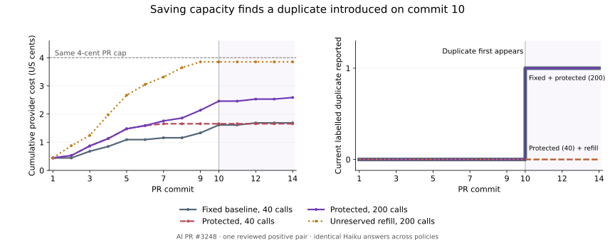

# Discovery across commits at four cents

Keep the current defaults. Cheaper exploration improves the reviewed recall substantially, but replacing the
baseline judge loses a known finding. The best protected development combination uses compact Sonnet on the
baseline and Haiku on exploration. It is a candidate for a warn-only experiment, not a promoted balanced profile.

This continues [protected exploration](protected-exploration.md). All scheduler arms have a **$0.04 cumulative
allowance per PR**, including earlier commits and failed paid responses. Costs below use provider-returned token
usage and the repository price table. They are usage-priced costs, not invoice reconciliation. Diagnostic calls
are accounted separately from each counterfactual PR budget.
The reference baseline is the earlier experiment's fixed shortlist with Sonnet v2. This is not an end-to-end
comparison against the shipping balanced preset's judge cascade.

## Policies and what protection means

The frozen comparison uses ten calls per revision and forty calls per PR. Protected discovery reserves $0.03
and twenty calls for baseline work, leaving $0.01 for exploration.
Baseline candidates always go first. Exploration receives up to $0.0025 per revision, with at most ten calls;
the one-call comparator gets the same dollar allowance. Unreserved refill spends whenever it can.

| Configuration | Baseline judge | Exploration judge | Report thresholds |
| --- | --- | --- | --- |
| Sonnet | Shared operations v2, 2,048 output tokens | Same | 0.6 |
| Compact | Compact shared operations v1, 512 tokens | Same | 0.6 |
| Haiku | Shared operations v2, 2,048 tokens | Same | 0.7 |
| Mixed | Sonnet v2 | Haiku v2 | Baseline 0.6, exploration 0.7 |
| Mixed compact | Compact Sonnet | Haiku v2 | Baseline 0.6, exploration 0.7 |

Models are `claude-sonnet-5-5` and `claude-haiku-5-5`. The complete-pool development pilot judged 72 versions:
both compact Sonnet at 0.6 and Haiku at 0.7 found all nine positive versions, rejected all 62 negatives, and did
not report the borderline case. Costs were $0.239534 and $0.0319847 respectively. The Haiku threshold was chosen
on those six development PRs and frozen before fresh judgments. This is calibration evidence, not held-out quality.

There are three different protections:

1. **Retrieval:** keep baseline candidates in the pool even when supplemental rankings disagree.
2. **Scheduling:** prefer current baseline candidates and reserve calls/dollars for later commits.
3. **Judging:** preserve the baseline model, prompt and threshold, or demonstrate that replacing them preserves
   findings. A cheap answer must be re-judged if it later enters a baseline using another judge.

A finite reserve cannot guarantee every finding the baseline-only counterfactual would afford. Admission
reserves a conservative input bound plus maximum output cost, even for cached experimental observations. Earlier
exploration can leave too little room for a later baseline request to be admitted, despite its eventual bill being
small. We compare actual baseline coverage and positive reports at every commit; baseline-first ordering alone
does not establish preservation.

## Previously labelled histories

The six development PRs and four earlier validation PRs are now development/regression data: 45 commits,
18 positive pairs in the final snapshots. Reference labels remain frozen. Recall is conditional on this reviewed
retrieval pool, not on all duplication in the repositories.

| Judge / scheduler | Final positives judged | Final positives reported | Attempts | USD across ten PRs | Unique true / false / unresolved reports |
| --- | ---: | ---: | ---: | ---: | ---: |
| Sonnet fixed | 2/18 | 2/18 | 13 | 0.065646 | 2 / 1 / 0 |
| Compact refill | 6/18 | 6/18 | 77 | 0.237690 | 8 / 1 / 0 |
| Haiku protected | 13/18 | 8/18 | 90 | 0.040916 | 8 / 0 / 1 |
| Mixed, one exploration call | 3/18 | 3/18 | 25 | 0.066681 | 3 / 0 / 0 |
| Mixed, dollar pacing | 3/18 | 3/18 | 36 | 0.070930 | 3 / 0 / 0 |
| Mixed compact, protected | 13/18 | 9/18 | 90 | 0.098385 | 9 / 0 / 1 |
| Mixed compact, refill | 15/18 | 11/18 | 151 | 0.123793 | 13 / 1 / 0 |
| Haiku refill, 200-call ceiling | 18/18 | 11/18 | 181 | 0.085394 | 13 / 1 / 1 |

The last row retains the $0.04 cap and raises only the secondary call ceiling. Unique report counts use exact
evidence/model versions across commits, so they need not equal final pair counts. The original Sonnet false report
is against the frozen reference; the earlier experiment's secondary adjudication considered that shared preparation
operation useful. It remains in the primary count instead of changing the reference to improve a result.

Mixed compact protected retained all coverage and both positive findings of its compact fixed counterfactual at
every commit. Both original Sonnet baseline positives also survived. Ordinary mixed dollar pacing lost one baseline
coverage snapshot, though no labelled baseline positive; the reserve is not an unconditional preservation proof.
Mixed compact refill gained two more final positives but produced a false report and lost three baseline coverage
snapshots against its fixed counterfactual.

The distinction between pre-judge and post-judge recall matters. Haiku with the higher call ceiling reached every
final reviewed positive in the old ten PRs, but reported only eleven. In the four regression PRs, it reached eleven
and reported four. Several answers correctly described a partial shared operation and then assigned 0.55 or 0.6
because it was small. One was a baseline event-link policy that Sonnet reported. Raising retrieval depth cannot
repair that reporting loss, and lowering the threshold after seeing these cases would need another validation set.

## Fresh validation

Four additional histories cover 28 commits: backend PRs #5570 and #5592, AI PRs #3248 and #3255. They contain 515
distinct evidence versions. Before fresh judge calls, we froze a 137-version reference panel: all baseline versions,
ten deterministically sampled non-baseline versions from each larger pool, and the complete two smaller pools.
The panel has two positive versions of one shelf-invalidation pair, 133 negatives and two borderline checkout
expiry versions. The remaining 378 versions are unknown. Source and reference packets stay private.

This is a baseline-enriched diagnostic panel. The positive family overlaps the earlier shelf-invalidation example;
it is a new PR history, not a new independent duplication family. Reported panel recall cannot establish population
recall or precision over unknown reports. Borderline and unreviewed pairs never become negatives.

| Judge / scheduler | Final panel positive reported | Attempts | USD across four PRs | Largest PR bill | True / false / unresolved reports |
| --- | ---: | ---: | ---: | ---: | ---: |
| Sonnet fixed | 0/1 | 7 | 0.030332 | 0.009138 | 0 / 0 / 0 |
| Compact fixed | 0/1 | 30 | 0.081832 | 0.030456 | 0 / 0 / 1 |
| Mixed compact protected | 0/1 | 38 | 0.085246 | 0.030456 | 0 / 0 / 1 |
| Haiku fixed, 40 calls | 1/1 | 70 | 0.027799 | 0.016850 | 2 / 0 / 0 |
| Haiku protected, 40 calls | 0/1 | 94 | 0.039277 | 0.016946 | 0 / 0 / 0 |
| Haiku refill, 200 calls | 0/1 | 190 | 0.085434 | 0.038522 | 0 / 0 / 0 |
| Haiku protected, 200 calls | 1/1 | 117 | 0.048588 | 0.025867 | 2 / 0 / 0 |

The higher-ceiling arms reserve 100 of 200 calls, retaining the same $0.03 baseline reserve and $0.04 total cap.
These caps and configurations were specified before fresh judgments. Across all arms, no PR exceeded $0.04.
The one unresolved compact report is a borderline expiry pair, not an unreviewed pair relabelled as a negative.
Cheap judging exposes a late baseline positive that neither Sonnet control could afford under its conservative
admission policy. Consequently, preservation against Sonnet alone would be a vacuous test for that fresh finding.

The fourteen-commit AI history makes the scheduling failure concrete:

| Policy on that PR | Calls | Final USD | Positive first reported |
| --- | ---: | ---: | --- |
| Haiku fixed, 40 calls | 40 | 0.016850 | Commit 10 |
| Haiku protected, 40 calls | 40 | 0.016556 | Never |
| Haiku refill, 200 calls | 84 | 0.038522 | Never |
| Haiku protected, 200 calls | 63 | 0.025867 | Commit 10 |

The positive first enters the candidate pool on commit 10. Protected forty-call exploration exhausts its call
allowance early, despite spending less than two cents. With 200 calls, unreserved refill instead spends almost
all the money by commit 9 and cannot admit the late request. Protected 200-call discovery retains every covered
baseline pair at every commit across all four fresh histories, and re-judges the changed positive on commit 12.
This supports reserving future capacity; it does not establish Haiku's general judging quality.



## Flexible pacing and implementation

`compare_history.py` now accepts separate baseline and exploration models, prompts, output limits and report
thresholds. Both share one physical spending ledger. Answer identity includes model, prompt and output policy.
Replays charge cached observations independently to each policy, but never buy the same answer again physically.
A paid invalid response consumes its attempt and dollars without becoming coverage or a negative verdict.
Unknown provider usage stops further spending. Historical reports retain the threshold used when they appeared.

Dollar pacing allows several cheap answers in a revision instead of exactly one. An optional carry bank also
lets unused credit accumulate, which can admit a larger request on a later commit. Each distinct commit earns
credit once; rerunning the same head cannot mint another allowance. The bank has a ceiling, spends actual usage,
and is always bounded by the campaign's remaining exploration and total budgets. This later sensitivity is
exploratory, separate from the frozen fresh comparison.

The later carry-bank sensitivity used only the old ten PRs and already-purchased answers. Banking up to $0.01
improved mixed compact protected from 9/18 to 11/18 final positives, with 131 calls costing $0.116152 across
ten PRs. Baseline coverage remained intact. It also introduced one frozen-reference false report and retained
one borderline report, so the extra coverage has a precision cost. Compact Sonnet on both routes gained nothing
from this bank: its maximum-cost reservations still did not fit the exploration allowance.

On the old ten PRs, ordinary mixed compact protected selected 13 positive and 76 negative evidence versions
(one borderline): pre-judge precision 13/89 and final positive coverage 13/18. Its judge reported 9 positives,
no frozen-reference negatives and one borderline. With the bank, the selected pool became 14 positive and
114 negative versions (three borderline), and reports became 11 positive, one negative and one borderline.
These are separate measurements of candidate yield, coverage, and judged report quality. A zero observed false
count on nine reports is not a precise estimate of production precision.

## Accounting and evidence

The entire new experiment made **554 physical paid attempts**, including diagnostics and one invalid answer:
**951,809 input tokens, 218,211 output tokens, $0.7492501**. No provider cache tokens were returned. The failure
cost $0.0004277, ended normally with 425 output tokens, and contained invalid JSON; it was not an output-cap
failure. It remains charged and unresolved, with no automatic retry or credit as coverage. This total is separate
from the previous experiment's $3.079554 and stayed below this turn's $5 research ceiling.

The 1,636.18 seconds of summed physical API duration is not wall-clock experiment time or CI latency. Shared
answers are bought once physically and charged independently to each counterfactual policy. Equal budget caps
do not imply equal realized spending: compare both the dollar column and the recall column.

The [aggregate results](four-cent-discovery-results.json) retain every tested arm, including weaker controls and
the post-evaluation carry sensitivity. The [commit curves](four-cent-discovery-curves.csv) record current and
eventual positives, spending, unknown coverage, and baseline losses. A lost snapshot counts one pair on one
commit; repeated snapshots are not independent examples. Private captures, labels and provider records are kept
outside the repository. Four fresh PRs with only one related positive family cannot support the required paired
precision/recall confidence bounds.

## Reproducing the policies

For example, the following replays the mixed compact protected policy and its fixed/refill controls:

```bash
uv run python scripts/compare_history.py \
  --captures private/captures --out private/mixed-compact --answers private/answers \
  --model claude-haiku-5-5 --prompt-policies shared-operations --max-tokens 2048 --report-at .7 \
  --baseline-model claude-sonnet-5-5 --baseline-prompt-policy shared-operations-compact \
  --baseline-max-tokens 512 --baseline-report-at .6 \
  --total-usd .04 --run-usd .04 --per-run 10 --total 40 \
  --reserve-usd .03 --reserve-calls 20 --exploration-per-run 10 --exploration-run-usd .0025 \
  --limit-usd 5
```

Add `--exploration-carry-usd .01` to bank unused pacing credit; use a separate output directory for this arm.
Raise `--total` and `--reserve-calls` together to test a dollar-limited campaign without the forty-call bottleneck.
The unchanged [capture and scoring commands](protected-exploration.md#reproduction) handle these results.
Use one answer-directory writer. These scripts are chronological research replays, not a concurrent CI scheduler.

The compact prompt is independently usable through the existing Anthropic plugin:

```toml
[tool.dry-lint]
judge = { use = "anthropic", model = "claude-sonnet-5-5", prompt_policy = "shared-operations-compact", max_tokens = 512 }
report_at = 0.6
```

That changes the judge only. It does not enable historical exploration, mixed routing or the replay's reservation
policy in production. Experimental answers have separate cache identities, and rollback to the legacy policy
does not reuse them.

## Balanced decision and next experiment

Keep mixed compact protected as an opt-in research policy. It is a better development tradeoff than the earlier
full Sonnet policy, but the [promotion gates](coverage-exploration.md#promotion-gates-and-rollout) remain unchanged.
The fresh positive sample is too small and related to earlier examples; the unknown pool is substantial. These
data cannot resolve precision noninferiority or establish a reliable held-out recall improvement.

The next useful experiment should use the existing second-opinion mechanism for cheap answers in an uncertain
score band, with its own reserved dollars, and evaluate shared-operation confidence separately from overlap size.
It must include negative controls, missed positives, revised evidence and provider-specific contracts. Simply
lowering Haiku's report threshold trades the observed misses for unmeasured false positives.

Before a new balanced default, validate the production judge cascade and cumulative concurrent budget ledger,
then run a warn-only pilot across complete review/merge cycles with independent fresh families. Measure end-to-end
p95 CI latency; summed serial API durations in this replay do not satisfy that gate. Separate high-precision and
high-recall profiles make sense only after these measured tradeoffs are explicit. Neither a larger `k` nor a profile
name solves judge calibration, maximum-cost admission, or spending too early in a long PR.
