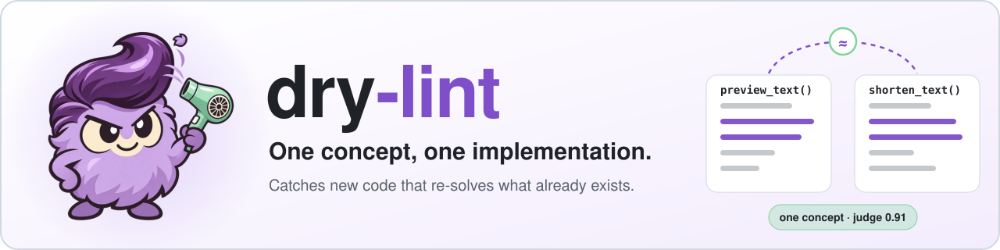

# One concept, one implementation

Coding agents rarely copy and paste. They write *new* code for a job the codebase
already does: a second `truncate`, another pagination loop, each slightly different.
Line-based copy detectors miss these rewrites, and every rewrite is a chance to drift.

dry-lint finds functions in a pull request that look like they re-implement
something that already exists. A judge decides whether each pair really is one
concept, and the result goes back as PR annotations and one comment.

## Set it up with your coding agent

Give Claude Code, Codex, Cursor or any coding agent in your repository this one prompt:

```text
Set up dry-lint in this repository. Fetch https://dry-lint.readthedocs.io/en/latest/agent-setup.md and follow it.
```

The agent reads how your repository works, writes the settings, accepts today's duplicates in a
baseline, adds the workflows and hooks, proves the check catches a copied function, and opens a pull
request. Secrets and repository settings stay with you: it stops and asks you to add a TypeSafe API key
secret if there is none, to make the `dry-lint` check required, and to add a token for the weekly cleanup
pull request. [Read the procedure it follows](../skills/dry-lint/SKILL.md), or do it by hand with the
[first-run tutorial](../docs/tutorials/first-run.md) and [how CI runs dry-lint](../docs/ci.md).

[Why dry-lint](../docs/why.md){ .md-button .md-button--primary }
[Tutorial: first run](../docs/tutorials/first-run.md){ .md-button }
[How CI runs it](../docs/ci.md){ .md-button }

```text
src/widgets/caption.py:1: preview_caption_text looks like src/text.py::shorten_text (drifted)
    judge 0.91; the two already behave differently; call the existing function;
    similarity 0.71; if they are different concepts, add
    `# dry-lint: distinct-from src/text.py::shorten_text`;
    if they are one concept copied on purpose, add a [[patterns]] entry with a reason
```

## Try it locally, without an API key

Install [uv](https://docs.astral.sh/uv/getting-started/installation/), open a
terminal in your Git repository, and run:

```bash
uvx --no-config --python 3.13 dry-lint scan --judge none --limit 30
```

This lists look-alikes without calling a model or failing on findings. Python,
TypeScript and TSX work out of the box; see [TypeScript and Bun](../docs/typescript.md)
for monorepos.

**You bring your own keys.** dry-lint never provides API keys, models or judge
execution: judges run on the credentials your repository passes in, at your cost,
and without any it only lists look-alikes ([design](../docs/design.md)).

## Find your way

| You want to | Read |
| --- | --- |
| Have a coding agent adopt it in one prompt | [Agent setup](../skills/dry-lint/SKILL.md) |
| Understand what it is for, with evidence | [Why dry-lint](../docs/why.md) |
| Know how it differs from jscpd, PMD CPD or Sonar | [Why dry-lint: compared with copy detectors](../docs/why.md#how-is-this-different-from-jscpd-pmd-cpd-or-sonar-duplication) |
| Go from a local scan to a required check | [First-run tutorial](../docs/tutorials/first-run.md) |
| See the whole CI flow: check, forks, ratchet, secrets | [How CI runs dry-lint](../docs/ci.md) |
| Look up an Action input | [GitHub Action reference](../docs/github-action.md) |
| Accept existing debt once and track its cleanup | [Sweeps and the ratchet](../docs/sweeps.md) |
| Choose a judge, its cost and its thresholds | [Judges and presets](../docs/judges.md) |
| Find duplicated data models, not only functions | [Model duplication](../docs/model-duplication.md) |
| Compare against other repositories | [Workspaces](../docs/workspaces.md) |
| See what the measurements do and do not show | [Benchmark](../docs/benchmark.md) |
